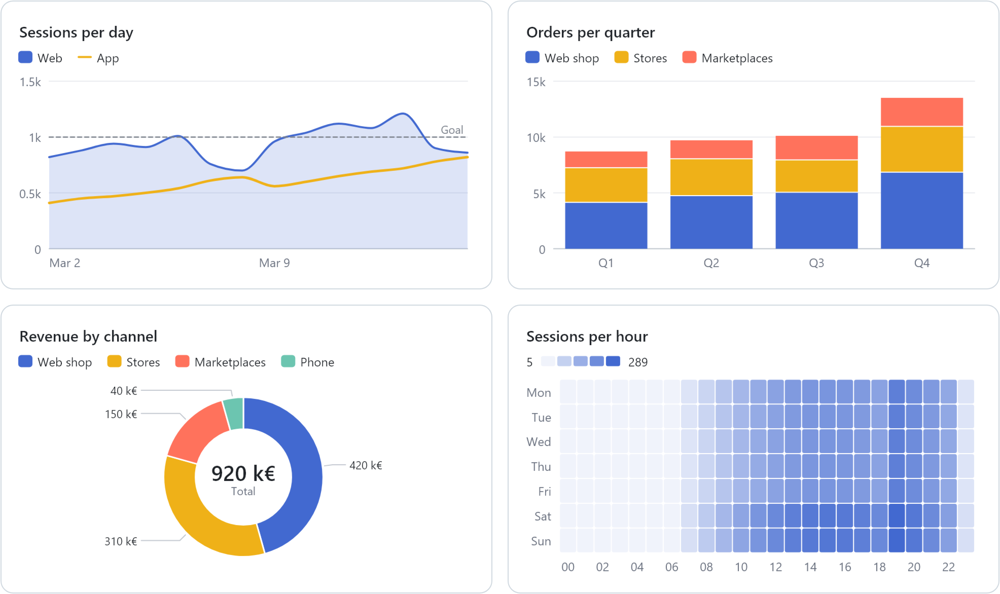

# RioCharts

**Charts for .NET.** One chart model, drawn everywhere: interactive in Blazor, PNG and SVG on the
server, and created by AI agents. C# does the math and layout; in Blazor, Razor renders SVG and a
tiny JS module only measures text and follows the pointer.



Drawn by RioCharts.Skia itself. **[See them live, with tooltips and zoom](https://riocharts.com/)**

> **Status: early preview.** APIs will change without notice before 1.0.
> Human-led, AI-built: the design is ours ([Design.md](https://github.com/joadan/RioCharts/blob/master/Design.md));
> most code is written by AI coding agents and tested and snapshot-checked before it ships.

## Blazor

```
dotnet add package RioCharts.Blazor --prerelease
```

Add `@using RioCharts.Blazor` and `@using RioCharts.Core` to `_Imports.razor`. That is all: no
services to register, and the styles come with your app's `{App}.styles.css` bundle.

```razor
<RioChart Items="orders" Title="Orders per day">
    <ReferenceLine Value="1000" Label="Goal" />
    <LineSeries Name="Web" XValue="o => o.Day" YValue="o => o.Web" />
    <BarSeries Name="App" XValue="o => o.Day" YValue="o => o.App" />
</RioChart>

@code {
    record DailyOrders(DateTime Day, double Web, double App);
    List<DailyOrders> orders = ...;
}
```

The axes, ticks, number and date formats, legend and colors come from the data; options are typed
parameters. Change `Items` and the chart draws again. It works on Server, WebAssembly and Auto, with
static rendering and prerendering, trimmed and native AOT, and in .NET MAUI Blazor Hybrid apps.

**Series:** line, area, range area, bar (grouped, stacked, horizontal), scatter with trend lines, bubble,
heatmap, box plot, histogram, range bar (timeline), candlestick, waterfall, pie, donut, radial bar, gauge, radar and treemap.

**Also in the box:** tooltips and crosshair, zoom and pan, linked charts, annotations, data labels,
click events, live data, large data (LTTB and a canvas layer), time zones, light and dark themes
through CSS variables, PNG/SVG/CSV download, keyboard navigation, screen reader descriptions and
built-in texts in eight languages.

## Images on the server

`RioCharts.Skia` draws the same charts as PNG or SVG without a browser, for reports, emails and
bots, with real font metrics and light or dark themes:

```csharp
var spec = new ChartDefinition { Title = "Sessions", Series = [new SeriesOptions { Id = "web", Name = "Web" }] };
var data = new Dictionary<string, SeriesData> { ["web"] = SeriesData.From(times, values) };
byte[] png = ChartExport.ToPng(spec, data, new ExportOptions { Width = 640, Height = 320 });
```

## AI agents

**In your app.** `RioCharts.AI` gives your agent `create_chart` and `render_chart` tools, as
Microsoft.Extensions.AI functions or MCP server tools. The agent writes a small JSON definition against
your datasets; the tool validates it, renders it and describes it:

```csharp
var tool = new ChartTool(new InMemoryDataSource([ChartDataset.FromItems("shop", rows, "Online store traffic per channel, hourly")]));
var chat = new ChatOptions { Tools = tool.AsAIFunctions() };
tool.ChartCreated += result => Show(result.Png);
```

**On your machine.** `riocharts-mcp` is a local MCP server for Claude Code, Claude Desktop, GitHub
Copilot and other agents. It renders charts from CSV and JSON files to PNG or SVG, and turns a
chart into `<RioChart>` markup for your app:

```
dotnet tool install -g RioCharts.Mcp --prerelease
```

```json
{ "mcpServers": { "riocharts": { "command": "riocharts-mcp", "args": ["--data", "data", "--out", "charts"] } } }
```

**Coding agents.** Models do not know RioCharts yet. Paste this into your repository's
`AGENTS.md` (or `CLAUDE.md`, `.github/copilot-instructions.md`):

```markdown
## Charts

Charts use RioCharts.Blazor (preview, .NET 10 and 11). Before writing chart code, read
https://riocharts.com/llms-full.txt, or call get_usage if the riocharts MCP server is set up.

- Setup: the RioCharts.Blazor package, and `@using RioCharts.Blazor` and `@using RioCharts.Core` in `_Imports.razor`. Nothing to register.
- Set `TItem` on `<RioChart>` when it has event handlers (`OnPointClick`, ...).
- A chart updates when `Items` is a new list or `DataVersion` changes, not when a list is changed in place.
- Tooltips, zoom and clicks need an interactive render mode on the page.
```

## Packages

All target .NET 10 (LTS) and .NET 11, and are previews: add `--prerelease`.

| Package | For |
| --- | --- |
| RioCharts.Blazor | The `<RioChart>` component and its series (includes Core) |
| RioCharts.Skia | PNG and SVG on the server |
| RioCharts.AI | `create_chart` and `render_chart` tools for AI agents |
| RioCharts.Mcp | `riocharts-mcp`, a local MCP server (a .NET tool) |
| RioCharts.Core | The chart engine alone: scales, layout and a render-agnostic scene, no UI dependencies |

## Learn more

- [Docs and live examples](https://riocharts.com/): every chart type and feature, running in your browser
- [Source, changelog and issues](https://github.com/joadan/RioCharts) on GitHub (MIT license)
